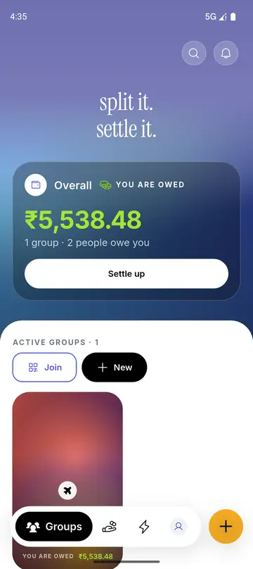
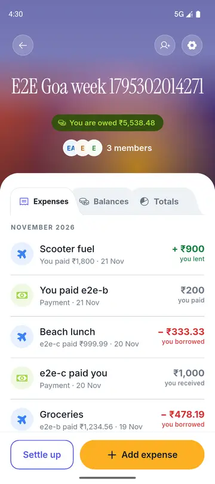
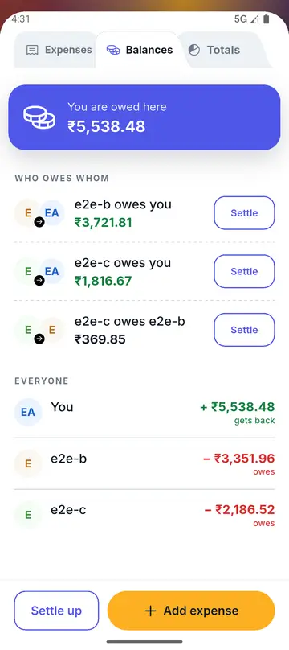
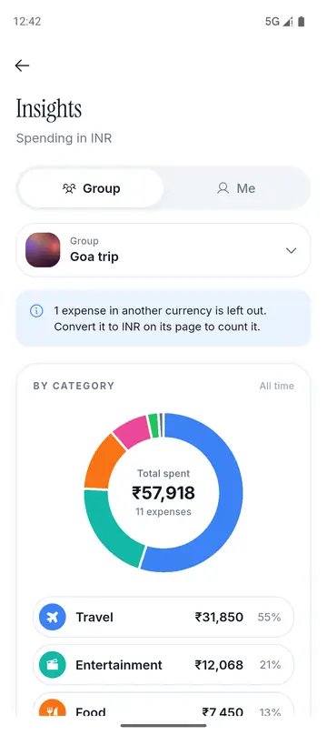

# Splitify Free Forever

Splitify is a free and open-source app for splitting expenses with friends, flatmates and groups. It is made for
India first (rupees, UPI) and works with other currencies too. You can track shared costs, see who owes whom and
settle up. It works offline. No ads, no limits, free forever.

## Features

- Sign in with Google or a one-time code sent by email.
- Groups for trips, homes and couples, with generated covers or your own photo. Add people by name; they can
  claim their spot later through an invite code or QR.
- Friends: see what you and each person owe across all your groups, and add expenses with just the two of you.
- Five ways to split (equally, exact amounts, percentages, shares, adjustments) and several people paying.
- Loans: money lent or borrowed outside a bill.
- Receipt photos.
- Balances per currency, with an optional "simplify debts" view that never changes what anyone owes overall.
- Settle up and pay via UPI. A payment is recorded only when you tap "Mark as paid".
- Works offline: everything is saved on the phone first and syncs when you are back online.
- Edit history for every expense and payment, and restore for deleted expenses, payments and groups.
- Comments on expenses and payments.
- Push and in-app notifications, and payment reminders.
- Other currencies, with the exchange rate saved on each expense.
- Repeating expenses (weekly, every 2 weeks, monthly, yearly).
- Search across all your expenses, even offline.
- Spending charts by category and month, and CSV export.
- Import a group from a Splitwise CSV export.
- App lock with your fingerprint or screen lock.
- Home screen widget with your overall balance.
- Light and dark themes.
- Optional payment bubble (off by default): after you pay with a UPI app, a bubble offers to add the payment
  to Splitify. Payment alerts are read on the phone, and nothing is sent until you tap Add. See
  [Privacy](docs/PRIVACY.md).

## Screenshots

| | | |
| --- | --- | --- |
|  |  |  |
|  |  |  |

## Status

Android first. Release APKs are published on GitHub Releases. There is no Play Store listing yet. iOS may come
later.

## Build from source

Android only for now. You need the [Flutter SDK](https://docs.flutter.dev/get-started/install) (stable, 3.50.x),
Android Studio (SDK + emulator) and JDK 17.

```powershell
. .\tool\env.ps1                                   # Windows: fixes PATH, sets JAVA_HOME
copy secrets\env.example.json secrets\env.dev.json # then fill in your own values (git-ignored)
flutter pub get
flutter run --dart-define-from-file=secrets/env.dev.json
```

Run all checks (format, analyze, guards, tests, coverage, debug APK) with `.\tool\verify.ps1`.
Never commit anything from `secrets/` except `*.example.json`.

## Self-hosting

The whole backend (database schema, security rules, Edge Functions) is in `supabase/`, so you can run your own
copy. See [supabase/README.md](supabase/README.md).

## Privacy

See [docs/PRIVACY.md](docs/PRIVACY.md). In short: no ads, no trackers, no selling data.

## Contributing

Contributions are welcome. Please read [CONTRIBUTING.md](CONTRIBUTING.md) before opening an issue or pull request,
and follow our [Code of Conduct](CODE_OF_CONDUCT.md).

## Security

Please do not report security issues in public. See [SECURITY.md](SECURITY.md).

## License

[MIT](LICENSE) © Unizoy
